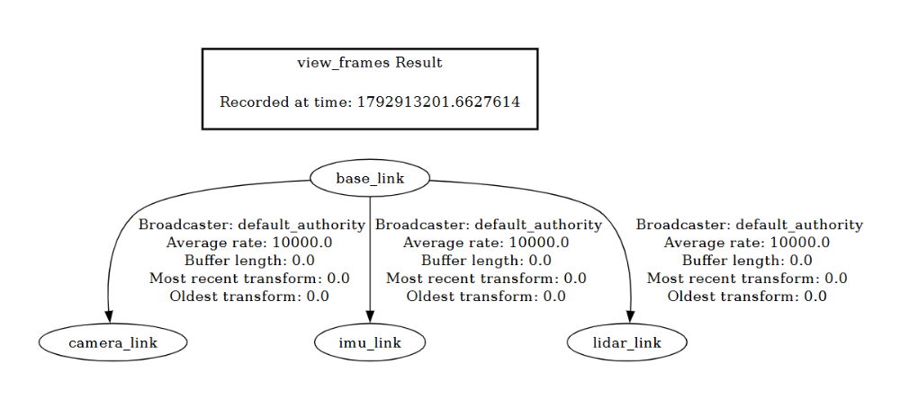
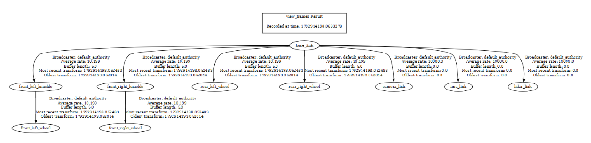

# PR06 frames — дерево TF модели course_ackermann

Источник геометрии: `models/course_ackermann/model.sdf` (только размеры,
массы, инерции и позы; Gazebo-плагины и сенсоры в URDF не переносились).
Единицы: СИ (м, кг, с), оси по REP-103 (X вперёд, Y влево, Z вверх).
Корневой frame: `base_link`.

## Дерево связей

| Parent | Child | Joint | Type | Expected transform | Owner / канал |
|---|---|---|---|---|---|
| base_link | camera_link | camera_joint | fixed | xyz=(0.28, 0.0, 0.38); rpy=(0,0,0) | robot_state_publisher, /tf_static |
| base_link | lidar_link | lidar_joint | fixed | xyz=(0.28, 0.0, 0.38); rpy=(0,0,0) | robot_state_publisher, /tf_static |
| base_link | imu_link | imu_joint | fixed | xyz=(0.28, 0.0, 0.38); rpy=(0,0,0) | robot_state_publisher, /tf_static |
| base_link | front_left_knuckle | front_left_steering_joint | revolute | xyz=(0.40, 0.31, 0.0); axis=z; limit=±0.55 рад, effort=25 | robot_state_publisher, /tf (только при /joint_states) |
| base_link | front_right_knuckle | front_right_steering_joint | revolute | xyz=(0.40, -0.31, 0.0); axis=z; limit=±0.55 рад, effort=25 | robot_state_publisher, /tf (только при /joint_states) |
| front_left_knuckle | front_left_wheel | front_left_wheel_joint | continuous | xyz=(0,0,0); origin rpy=(-π/2,0,0); локальная ось z = модельная +Y | robot_state_publisher, /tf (только при /joint_states) |
| front_right_knuckle | front_right_wheel | front_right_wheel_joint | continuous | xyz=(0,0,0); origin rpy=(-π/2,0,0); локальная ось z = модельная +Y | robot_state_publisher, /tf (только при /joint_states) |
| base_link | rear_left_wheel | rear_left_wheel_joint | continuous | xyz=(-0.40, 0.31, 0.0); origin rpy=(-π/2,0,0); локальная ось z = модельная +Y | robot_state_publisher, /tf (только при /joint_states) |
| base_link | rear_right_wheel | rear_right_wheel_joint | continuous | xyz=(-0.40, -0.31, 0.0); origin rpy=(-π/2,0,0); локальная ось z = модельная +Y | robot_state_publisher, /tf (только при /joint_states) |

Параметры макета (из SDF): wheelbase=0.80 м, track=0.62 м,
wheel_radius=0.12 м, wheel_width=0.07 м.

## Владельцы публикации

- Все связи публикует ровно одна нода: `robot_state_publisher`.
- Фиксированные связи (`camera_joint`, `lidar_joint`, `imu_joint`)
  попадают в `/tf_static` с профилем RELIABLE + TRANSIENT_LOCAL
  (History KEEP_LAST(1)).
- Подвижные связи (рулевые `revolute` и колёсные `continuous`)
  попадают в `/tf` только когда кто-то публикует `/joint_states`.
  Без `/joint_states` `robot_state_publisher` не знает текущие углы
  суставов и не публикует их преобразования — это ожидаемо и не
  является ошибкой модели.
- Других издателей `/tf_static` быть не должно. Перед повторным
  запуском останавливается предыдущий launch (два издателя дают
  случайный ответ у подписчика).

## Подтверждение фиксированных связей

Снято при работающем `robot_state_publisher`, `echo --once` с
профилем transient_local, `exit=0`:

```text
base_link -> camera_link : translation (0.28, 0.0, 0.38), rotation (0,0,0,1)
base_link -> imu_link    : translation (0.28, 0.0, 0.38), rotation (0,0,0,1)
base_link -> lidar_link  : translation (0.28, 0.0, 0.38), rotation (0,0,0,1)
```

## Скриншоты дерева TF

### Только фиксированные связи (/tf_static)

RViz при запущенном `robot_state_publisher` без `/joint_states`:
в дереве TF видны `base_link`, `camera_link`, `lidar_link`, `imu_link`.
Колёса и рулевые кулаки отсутствуют — это ожидаемо, они публикуются
в `/tf` только при наличии `/joint_states`.



### Полное дерево (/tf_static + /tf при /joint_states)

После публикации нулевых `/joint_states` для всех шести суставов
в дереве TF появились подвижные звенья:
`front_left_knuckle`, `front_right_knuckle`,
`front_left_wheel`, `front_right_wheel`,
`rear_left_wheel`, `rear_right_wheel`.

